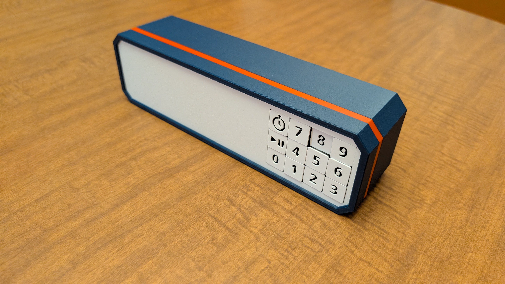
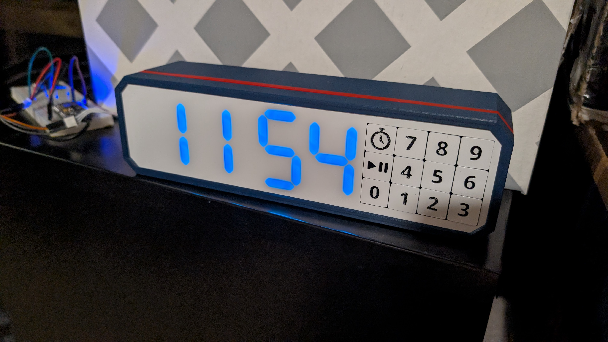
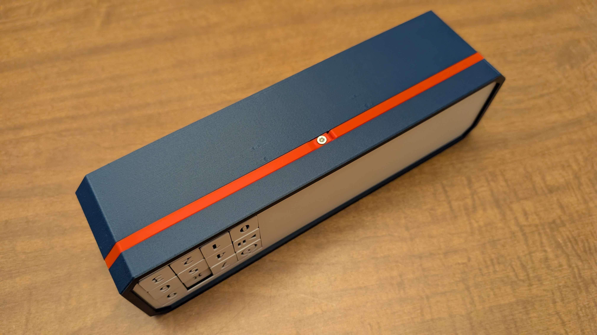

TV Timer for James. I've been wanting to make 3D printed seven segment displays using RGB LEDs to get big, bright digits that don't cost a fortune. (Why are they so small, and big ones so expensive???) Thia had the idea to use them to make a timer that James can use for screen time. (He's been the oven timer but we keep the kitchen closed off from the kids some of the time.)

The star of the show is the 3D printed body, with seven segment digits, custom indicators, and a 3x4 keypad, all 3D printed. The front and back of the case are held together with a band with a single screw at the bottom, inspired by the kidchenaid mixer design, so that the visible part of the case is entirely free of fasteners. I quite like the look of it too. The back has a hole for the USB C port on the Xiao mainboard, and a speaker grill. There's also a couple of weight compartments inside to add weight near the bottom, to improve the feel and make it less likely to slide around everywhere.

Electronics:
- WS2812 style 5mm LEDs on custom PCBs to make digits and indicators
- MX style keyswitches with diodes on custom PCB for the keypad
- Xiao ESP32-C6 on a piece of proto board for the mainboard
- Adafruit audio BFF and 40mm speaker to add audio

Software:
- EspHome for easy integration with Home Assistant, easy OTA updates, and pre-existing support for single wire LEDs and matrix keypads. (Probably I2S too haven't figured that out yet.)
- Will create custom (a) component(s) for turning single-wire led strand into digits and for the actual timer logic

Features: (Planned)
- Clock mode: When timer is not being used, it will show the current time
- Timer mode: Press the timer button and enter a time to start a timer.
  - Timer indicator shows it's in timer mode instead of clock mode
  - May also have different colors per mode
  - Timer can be paused and resumed with timer button
  - Timer can be cancelled with timer button (3-2-1 countdown?)
- Count Up mode: After a timer completes, the display will start counting up the time since the timer ended
  - Maybe after a short delay?
  - Likely with a different color/animation, may blink the timer indicator.
- Home Assistant integration
  - Control timer from Home Assistant (Start/stop/set time etc)
  - Timer complete events for use in automations
  - Use count-up in integrations (Ex: Turn off TV if timer has been going off for 5 min)
  - Control Lock? Remotely lock out keypad from Home Assistant

## Status
Note: I actually have to separate instances in progress currently. One for the TV, and one I'll use for myself (Show and tell? Clock? Take to work? All of the above?)

Task        | Status | Details
----------- | ------ | -------
SSDs        |  100%  | Design a 3D Printable seven segment display for use with 5mm LEDs with good vision
Enclosure   |  100%  | Design an enclosure to hold everything together, including keypad and indicators
PCBs        |  100%  | Design and order custom PCBs to wire-up LEDs and keypad (hand wiring these _sucks_)
Elec. Asm.  |   75%  | Solder up LEDs and keys, and the mainboard, and make wiring harnesses and figure out how everything connects
Weights     |    0%  | Add weight to the case with plaster of paris/concrete/metal scrap or whatever to improve feel and function
3D Printing |   95%  | Actually print all the parts and do the necessary post processing.
Assemble    |   50%  | Assemble everything together
Software    |    0%  | Here be dragons
HASS        |    0%  | Create some fun automations/dashboards to work with the timer!

## Dev Pictures
This picture shows the digits lit up showing the time

I'm pretty proud of the way the case is held together with a band and a single screw to keep the band in place.
